<a href="https://rushlabs.ai"><picture><source media="(max-width: 767px) and (prefers-color-scheme: dark)" srcset="assets/header-m-dark.b7eceae.svg"><source media="(max-width: 767px)" srcset="assets/header-m-light.b7eceae.svg"><source media="(prefers-color-scheme: dark)" srcset="assets/header-dark.b7eceae.svg"></picture></a>

<a href="https://github.com/rushlabs-ai/tunekeep"><picture><source media="(max-width: 767px) and (prefers-color-scheme: dark)" srcset="assets/card-m-tunekeep-dark.b7eceae.svg"><source media="(max-width: 767px)" srcset="assets/card-m-tunekeep-light.b7eceae.svg"><source media="(prefers-color-scheme: dark)" srcset="assets/card-tunekeep-dark.b7eceae.svg"></picture></a><a href="https://github.com/rushlabs-ai/crosscheck"><picture><source media="(max-width: 767px) and (prefers-color-scheme: dark)" srcset="assets/card-m-crosscheck-dark.b7eceae.svg"><source media="(max-width: 767px)" srcset="assets/card-m-crosscheck-light.b7eceae.svg"><source media="(prefers-color-scheme: dark)" srcset="assets/card-crosscheck-dark.b7eceae.svg"></picture></a>

<a href="https://github.com/rushlabs-ai/rerankd"><picture><source media="(max-width: 767px) and (prefers-color-scheme: dark)" srcset="assets/card-m-rerankd-dark.b7eceae.svg"><source media="(max-width: 767px)" srcset="assets/card-m-rerankd-light.b7eceae.svg"><source media="(prefers-color-scheme: dark)" srcset="assets/card-rerankd-dark.b7eceae.svg"></picture></a><a href="https://github.com/rushlabs-ai/rush-index"><picture><source media="(max-width: 767px) and (prefers-color-scheme: dark)" srcset="assets/card-m-rush-index-dark.b7eceae.svg"><source media="(max-width: 767px)" srcset="assets/card-m-rush-index-light.b7eceae.svg"><source media="(prefers-color-scheme: dark)" srcset="assets/card-rush-index-dark.b7eceae.svg"></picture></a>

<a href="https://github.com/rushlabs-ai/rush-small"><picture><source media="(max-width: 767px) and (prefers-color-scheme: dark)" srcset="assets/card-m-rush-small-dark.b7eceae.svg"><source media="(max-width: 767px)" srcset="assets/card-m-rush-small-light.b7eceae.svg"><source media="(prefers-color-scheme: dark)" srcset="assets/card-rush-small-dark.b7eceae.svg"></picture></a><a href="https://rushlabs.ai"><picture><source media="(max-width: 767px) and (prefers-color-scheme: dark)" srcset="assets/card-m-lab-dark.b7eceae.svg"><source media="(max-width: 767px)" srcset="assets/card-m-lab-light.b7eceae.svg"><source media="(prefers-color-scheme: dark)" srcset="assets/card-lab-dark.b7eceae.svg"></picture></a>

 <a href="https://rushlabs.ai">rushlabs.ai</a>&nbsp;&nbsp;&nbsp;&nbsp; <a href="mailto:admin@rushlabs.ai">admin@rushlabs.ai</a>

